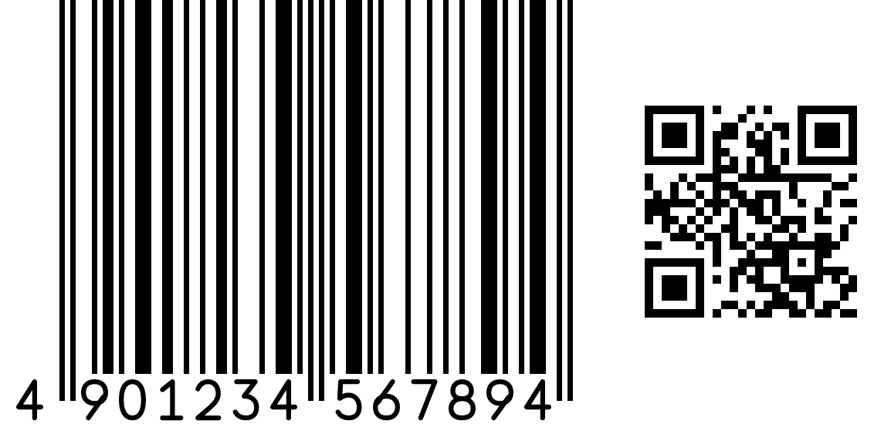

# BarBridge

[English](README.md) | 日本語

**GS1 Sunrise 2027 対応の 1D/2D バーコードペア生成を行う、言語非依存のコア
ライブラリ（Rust製）。C ABI 境界ごしにどの言語からでも利用できます。**

## これは何か

2027年、GS1は小売POSのバーコード運用を、1D単体（EAN/UPC等）から2D(GS1 QR
Code / GS1 DataMatrix)とのペア表示へ移行させます ── **GS1 Sunrise 2027**
です。これによりロット番号や賞味期限などの属性データをGTINと一緒に1つの
シンボルに載せられるようになりますが、移行期間中は小売店・メーカー側で
両方のシンボルを正しいサイズ・レイアウトで一緒に印刷する必要があります。

BarBridgeはこの移行のために作られたコアライブラリです。GS1規格に準拠した
1D/2Dバーコードペアを生成し、指定した枠(例: 50mm×50mm)に収まる範囲で
GS1規格内最大のサイズを自動計算して、メモリ上のラスタ・PNG・SVGとして
描画します。



## コンセプト

- **GS1準拠のサイズ最適化**: バーコードの印字サイズ(X寸法)をGS1規格の
  範囲内に保ちながら、指定出力サイズに収まる最適倍率を計算します。
- **1D + 2D の組み合わせ描画**: 同一GTINを表す1Dシンボルと2Dシンボルを、
  適切な配置(横並び/縦積み)で自動的にペア描画します。
- **言語非依存のRust製コア**: ロジックは単一の安全でメモリ効率の良い
  Rustコアに集約され、**C ABI境界**ごしに公開されます。C ABIを呼べる
  言語であれば、薄いバインディングを介してどの言語からでも利用でき、
  コア自体にJVM・Node・Pythonインタプリタへの依存はありません。
- **クロスプラットフォーム・多言語対応**: Windows / macOS / Linux 向けの
  単一実装を、Python / C・C++ / C# / VB.NET / PHP / Java / Node.js(後述)
  とブラウザ(WebAssembly)から呼び出せます。
- **すべてメモリ上で完結**: コアはメモリ(ラスタバッファ、またはPNG/SVGの
  バイト列)に直接描画し、呼び出し側プロセスがそのメモリを所有します。
  一時ファイル・サブプロセス・外部CLIツールは一切不要です。

## 対応規格

- 1D: EAN-13 / EAN-8 / UPC-A / UPC-E
- 2D: GS1 QR Code、GS1 DataMatrix
- GS1 Digital Link(GTIN・属性データのURI表現)
- GS1-128、GS1 DataBar等の物流・ケースラベル系シンボルは今後対応予定です。

## サンプル: 各言語からBarBridgeを呼び出す

`windows-x64/` と `windows-arm64/` にはそれぞれ対応言語ごとの最小サンプルが
入っており、すべて同じネイティブライブラリ(`barbridge.dll`)をC ABI経由で
呼び出します。

```
barbridge/
├── barbridge.h       # C ABIヘッダ (C/C++, cgo 等)
├── windows-x64/       # Windows (x64)
└── windows-arm64/      # Windows (ARM64)
    ├── native/barbridge.dll, barbridge.dll.lib
    ├── common/request.json   # サンプル共通のGS1データ
    ├── c/          # C (barbridge.dll.lib をリンク)
    ├── python/     # ctypes、標準ライブラリのみ
    ├── csharp/     # P/Invoke、`dotnet run`
    ├── vb/         # P/Invoke、`dotnet run`
    ├── java/       # JNA、`mvn package`
    ├── php/        # 組み込みFFI拡張 (PHP 7.4+)
    └── nodejs/     # koffi (ビルド不要・プリビルド済みFFI)
```

各サンプルは `../common/request.json` を読み込み、`barbridge_render_png`
を呼び出して `output.png` を自分と同じフォルダに書き出します。どの言語でも
パターンは同じです: JSONリクエスト文字列を渡す → PNGバイト列を受け取る →
使い終わったらバッファを解放する。

| 言語 | バインディング方式 | 実行方法 |
|---|---|---|
| Python | `ctypes`(標準ライブラリのみ) | `python render_sample.py` |
| C / C++ | `barbridge.dll.lib` をリンク | `render_sample.c` 冒頭のコメント参照 |
| C# | P/Invoke | `dotnet run` |
| VB.NET | P/Invoke | `dotnet run` |
| Java | JNA | `mvn package && java -jar target/barbridge-sample-jar-with-dependencies.jar` |
| PHP | 組み込み `FFI` 拡張 | `php render_sample.php` |
| Node.js | [`koffi`](https://koffi.dev/)(npm、プリビルド済みバイナリ) | `npm install && node render_sample.js` |

ライブラリを別の場所に置いている場合は、相対パスの代わりに環境変数
`BARBRIDGE_NATIVE_LIB` でそのパスを指定できます。

macOS(arm64/x64)・Linux(arm64/x64)向けの同構成サンプルは今後公開予定です。

## 公開しているAPI(上記サンプルで使用)

C宣言の全体は [`barbridge.h`](barbridge.h) を参照してください(生ラスタ
出力、呼び出し側バッファへの`render_into`、SVG、レイアウト情報JSON等)。
サンプルでは次の最小限のパスのみを使用しています。

| 関数 | 説明 |
|---|---|
| `barbridge_render_png(request_json, &out_data, &out_len)` | GS1の1D+2Dペア(または単体シンボル)をメモリ上でPNGバイト列として描画 |
| `barbridge_bytes_free(data, len)` | 上記で返されたバッファを解放(使い終わったら必ず呼ぶこと) |
| `barbridge_last_error()` | 直前の失敗の人間可読な理由 |

### リクエストJSON(抜粋)

```json
{
  "data": "(01)04901234567894(10)LOT42(17)271231",
  "mode": "pair",
  "matrix": "data_matrix",
  "arrangement": "auto",
  "max_width_mm": 50,
  "max_height_mm": 50,
  "dpi": 600
}
```

`data` にはGS1 AI要素文字列(`(01)GTIN(10)LOT…`)、またはGTIN-8/12/13/14
の数字のみを指定できます。`mode` は `pair`(既定)・`linear`(1D単体)・
`matrix`(2D単体)です。全フィールドは [`barbridge.h`](barbridge.h) を
参照してください。

## License

[Apache License, Version 2.0](LICENSE-APACHE) または [MIT license](LICENSE-MIT) のいずれかを選択できます。
