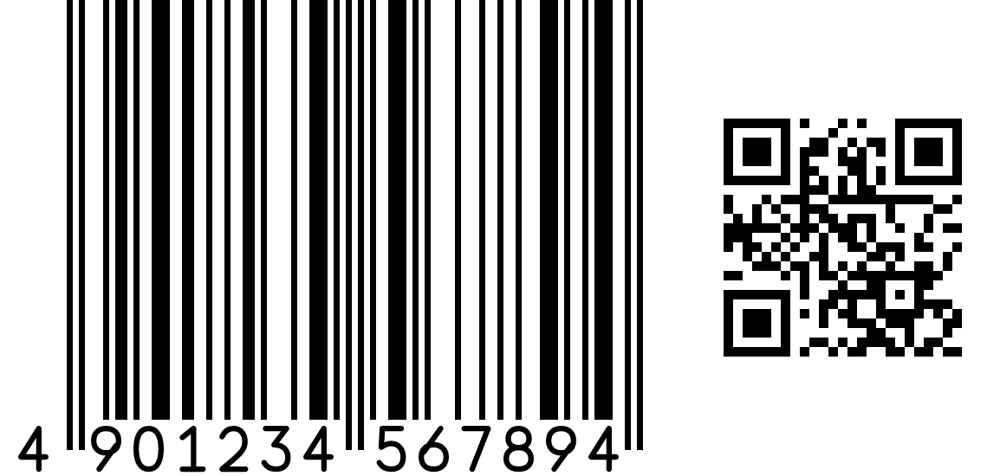

# BarBridge

English | [日本語](README.ja.md)

**A language-independent core for GS1 Sunrise 2027 1D/2D barcode generation,
written in Rust, usable from any language across a C ABI boundary.**

## What this is

In 2027, GS1 is moving retail POS barcode practice away from 1D-only symbols
(EAN/UPC, etc.) toward pairing them with 2D symbols (GS1 QR Code / GS1
DataMatrix) — the **GS1 Sunrise 2027** initiative. This lets a single symbol
carry attribute data such as lot number and expiration date alongside the
GTIN, but during the transition period, retailers and manufacturers need to
print both symbol types together, at the right size and layout.

BarBridge is a core library built for this transition: it generates 1D/2D
barcode pairs that conform to GS1 specifications, computing the largest
GS1-compliant print size that still fits your target footprint (e.g. 50mm ×
50mm), and renders them as an in-memory raster, PNG, or SVG.



## Concept

- **GS1-compliant size optimization**: computes the optimal scale so the
  barcode's print size (X-dimension) stays within GS1's specified range
  while automatically fitting a target output size.
- **Combined 1D + 2D rendering**: automatically selects an appropriate
  arrangement (side-by-side, stacked) to pair a 1D symbol and a 2D symbol
  representing the same GTIN.
- **A language-independent core, written in Rust**: the logic lives in a
  single safe, memory-efficient Rust core exposed across a **C ABI
  boundary**, so any language that can call a C ABI can use it through thin,
  language-specific bindings — no JVM, Node, or Python interpreter required
  for the core itself.
- **Cross-platform, multi-language**: a single core implementation
  targeting Windows / macOS / Linux, callable from Python, C/C++, C#,
  VB.NET, PHP, Java, and Node.js (see below), plus the browser via
  WebAssembly.
- **Everything happens in memory**: the core renders directly into memory
  (a raster buffer or a PNG/SVG byte buffer) that your own process owns —
  no temp files, no subprocess, no external CLI tool required.

## Supported standards

- 1D: EAN-13 / EAN-8 / UPC-A / UPC-E
- 2D: GS1 QR Code, GS1 DataMatrix
- GS1-128, GS1 DataBar, and other logistics/case-label symbologies are
  planned next.

### What the 2D symbol actually encodes

By default (`content: "auto"`), the two 2D symbol types encode different
payloads, matching how they're actually scanned in the field:

- **GS1 QR Code** → a **GS1 Digital Link** URI
  (`https://id.gs1.org/01/{GTIN14}/10/{LOT}/17/{EXP}...`), so it opens
  directly in any phone camera as well as a POS/logistics scanner.
- **GS1 DataMatrix** → the raw **GS1 element string** (FNC1 + AI pairs,
  e.g. `(01)04901234567894(10)LOT42(17)271231`), the format POS/logistics
  scanners expect from a DataMatrix.

Pass `content: "digital_link"` or `content: "element_string"` to force
one or the other for either symbol type. GS1 Digital Link is currently
**output-only**: a Digital Link URI is not yet accepted as `data` input
(only a GS1 element string or a bare GTIN-8/12/13/14 are).

## Samples: call BarBridge from your language

`windows-x64/` contains a self-contained, minimal sample for each
supported language, all calling the same native library
(`barbridge.dll`) through its C ABI:

```
barbridge/
├── barbridge.h       # C ABI header (C/C++, cgo, ...)
└── windows-x64/       # Windows (x64)
    ├── native/barbridge.dll, barbridge.dll.lib
    ├── common/request.json   # shared sample GS1 data
    ├── c/          # C (link against barbridge.dll.lib)
    ├── python/     # ctypes, standard library only
    ├── csharp/     # P/Invoke, `dotnet run`
    ├── vb/         # P/Invoke, `dotnet run`
    ├── java/       # JNA, `mvn package`
    ├── php/        # built-in FFI extension (PHP 7.4+)
    └── nodejs/     # koffi (prebuilt-binary FFI, no native build toolchain)
```

Each sample reads `../common/request.json`, calls `barbridge_render_png`,
and writes `output.png` next to itself. Usage is the same pattern across
every language: pass a JSON request string in, get PNG bytes back, free
the buffer when done.

| Language | Binding | Run |
|---|---|---|
| Python | `ctypes` (stdlib only) | `python render_sample.py` |
| C / C++ | link against `barbridge.dll.lib` | see comment header in `render_sample.c` |
| C# | P/Invoke | `dotnet run` |
| VB.NET | P/Invoke | `dotnet run` |
| Java | JNA | `mvn package && java -jar target/barbridge-sample-jar-with-dependencies.jar` |
| PHP | built-in `FFI` extension | `php render_sample.php` |
| Node.js | [`koffi`](https://koffi.dev/) (npm, prebuilt binary) | `npm install && node render_sample.js` |

If you keep the library somewhere else, point the `BARBRIDGE_NATIVE_LIB`
environment variable at it instead of relying on the relative path.

Only `windows-x64/` is published here for now. macOS (arm64/x64) and
Linux (arm64/x64) builds of the same sample set are planned.

## Exposed API (used by the samples above)

See [`barbridge.h`](barbridge.h) for the full C declarations (raw raster
output, `render_into` for caller-owned buffers, SVG, layout info JSON,
etc.). The samples only use this minimal path:

| Function | Description |
|---|---|
| `barbridge_render_png(request_json, &out_data, &out_len)` | Renders a GS1 1D+2D pair (or a single symbol) to PNG bytes in memory |
| `barbridge_bytes_free(data, len)` | Frees the buffer returned above (always call this once you're done with it) |
| `barbridge_last_error()` | Human-readable reason for the most recent failure |

### Request JSON (abridged)

```json
{
  "data": "(01)04901234567894(10)LOT42(17)271231",
  "mode": "pair",
  "matrix": "data_matrix",
  "arrangement": "auto",
  "max_width_mm": 50,
  "max_height_mm": 50,
  "dpi": 600
}
```

`data` accepts a GS1 AI element string (`(01)GTIN(10)LOT…`) or a bare
GTIN-8/12/13/14. `mode` is `pair` (default), `linear` (1D only), or
`matrix` (2D only). See [`barbridge.h`](barbridge.h) for every field.

## License

Licensed under either of [Apache License, Version 2.0](LICENSE-APACHE) or
[MIT license](LICENSE-MIT) at your option.
